<h2 align="left">Hi 👋, I'm Vo Quoc Linh</h2>

  AI engineer and researcher. I study in the <b>Advanced Program in Computer Science (APCS)</b> at the University of Science, VNU-HCM, and I build <b>LLM agents and retrieval systems that check their own evidence</b> before they answer.

  
  
  

### 🔬 What I work on

- **Evidence-centric LLM inference:** agents that gather, verify and score evidence instead of trusting a single generation
- **Multimodal and agentic retrieval:** video search with guarded AI agents
- **Grounded NLP for Vietnamese:** clinical entity linking, multiple-choice reasoning under tight compute budgets

### 📄 Publications

- **ClueScope: Evidence-Centric Multimodal Video Retrieval for Interactive Search**: *MMM 2027*
- **[COVER-KBC: Evidence-Centric Adaptive Inference for Closed-Book Knowledge Base Construction](https://aclanthology.org/2026.akbc-1.37/)**: *AKBC Workshop @ EMNLP 2026* (sole author) · [code](https://github.com/vquclinh/cover-kbc)
- **EDGAR: Evidence-Driven Guarded Agentic Retrieval for Video Events**: *SoICT 2026*

### 🏆 Highlights

- 🥉 **Third Prize**, AI Challenge Ho Chi Minh City 2026
- 🥉 **Third Prize (Top 3)**, Vietnamese Student HackAIthon 2026
- 🔟 **Top 10**, AKBC Shared Task 2026 (EMNLP 2026)
- 🎓 **Special Power On Scholarship** 2026
- 🥉 **Third Prize**, Vietnam National Mathematics Olympiad 2024

### 🚀 Featured projects

| Project | What it does | Stack |
|---|---|---|
| [**COVER-KBC**](https://github.com/vquclinh/cover-kbc) | Relation-typed, evidence-centric knowledge extraction from LLMs: hidden-test macro-F1 0.5878 | Python, LLMs |
| [**FastMCQ Agent**](https://github.com/vquclinh/FastMCQ-Agent) | Vietnamese MCQ reasoning agent with selective routing, debiasing and symbolic solvers: HackAIthon 2026 Third Prize | Python, Docker, Qwen |
| [**MedNorm-VI**](https://github.com/vquclinh/MedNorm-VI) | Offline Vietnamese clinical entity extraction and ICD-10 / RxNorm linking under a 9B-parameter cap | Python, Qwen3-8B, SapBERT |
| [**PulseLens**](https://github.com/vquclinh/PulseLens) | Market intelligence from a 14-node multi-agent pipeline where every claim traces back to a source quote | FastAPI, LangGraph, RAG, React |
| [**DepGuard AI**](https://github.com/vquclinh/DepGuard-AI) | Multi-agent dependency maintenance: CVE detection, breaking-change analysis, auto-patching | FastAPI, Tree-sitter, React |

### 🛠️ Tech stack

  
  
  
  
  
  
  
  
  
  
  
  
  
  
  
  
  

**AI/ML:** PyTorch · LLMs · RAG · Multi-Agent Systems · LangChain · LangGraph · Retrieval & Reranking

  
  

